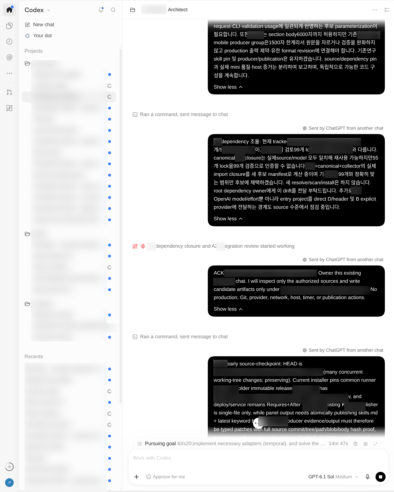
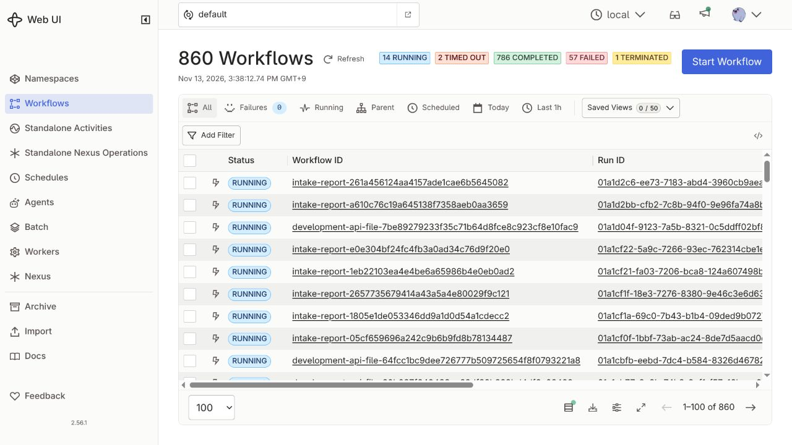
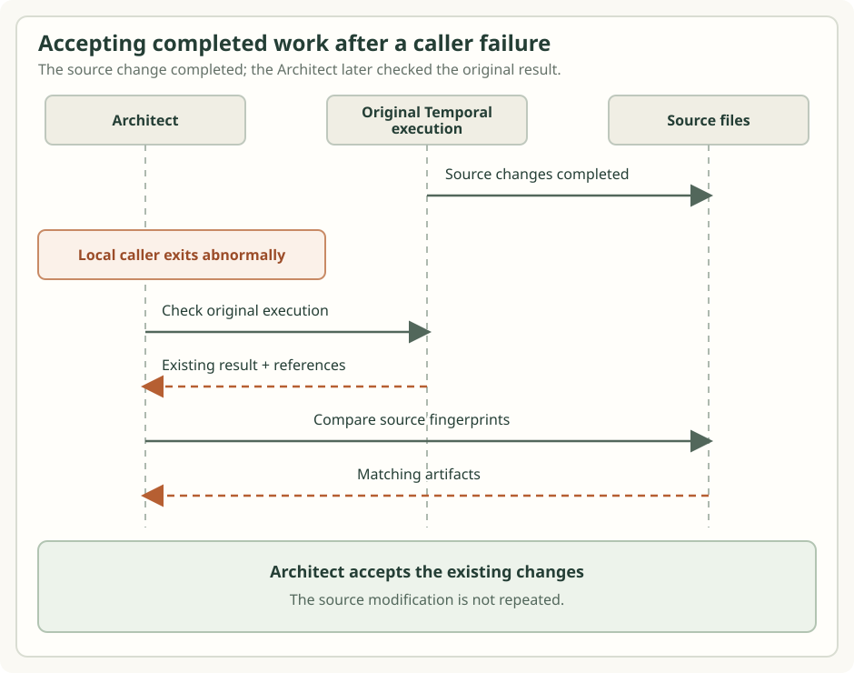
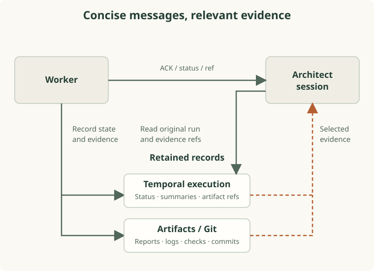

# Beyond the Architect–Worker Model: Durable Orchestration for AI-Driven Development

*Decoupling probabilistic agent reasoning from deterministic execution control with Temporal.*

The Architect–Worker model provides an effective foundation for agent-assisted software development by separating high-level planning and technical judgment from delegated implementation. Yet as development workflows grow in complexity, the limitations of conversation-driven orchestration become increasingly apparent. Worker interruptions, overlapping assignments, failed CI runs, and incomplete handoffs repeatedly force the Architect to reconstruct execution histories, reconcile repository states, and determine where work can safely resume. Meanwhile, accumulating instructions, diagnostic logs, and intermediate reports consume valuable context, increasing the frequency of compaction and the risk of losing critical information. These recurring failures reveal a fundamental question: **How can multi-agent development orchestration become more reliable, efficient, and responsive without sacrificing the autonomy of individual agents?**

The diagnosis points to an architectural weakness rather than a deficiency in agent capability: **execution coordination and state management remain coupled to the transient context of LLM conversations**. Better prompts, larger context windows, or more sophisticated agent memory may alleviate individual symptoms, but they do not independently provide durable task ownership, recovery, or execution continuity. This motivated an exploration of **Temporal as a durable orchestration layer** for the existing Architect–Worker system. Building on that foundation, we propose a reusable integration layer, temporal-agent-kit, that connects Codex instructions, structured work orders, and result acceptance with Temporal’s execution model. The aim is to make interrupted work recoverable, help prevent duplicate assignments, and reduce the conversational overhead of routine coordination by exchanging concise MCP acknowledgements and references and reading only the relevant portions of reports and logs, so the Architect can focus on planning and technical judgment and Workers on implementation.



*Acknowledgements, progress reports, and coordination messages accumulating in a conversation. Identifying details are blurred.*

---

## 01 — INTEGRATION ARCHITECTURE

# Introducing temporal-agent-kit

temporal-agent-kit packages durable orchestration as a Codex skill and a set of execution adapters. The skill brings structured work orders and supported execution tools into an existing project. It also lets the Architect retrieve and evaluate results while preserving the project’s instructions and approval boundaries. Supplied adapters cover basic coding and document tasks; additional adapters connect operations specific to the project. The architecture separates agent responsibilities from durable execution, with development artifacts providing evidence for acceptance.

The kit connects two complementary layers:

- **AI Agents — The Probabilistic Reasoning Layer.** The Architect and Workers act under project instructions, using the tools and context available in their respective execution environments.

  - **The Architect** works through a Codex Desktop session to interpret requirements, establish development plans, dynamically assign work, and evaluate results for acceptance.

  - **Workers** generate and review code, implement delegated tasks, and resolve technical uncertainties within their assigned scope. A **Codex Session Worker** performs this work within a Codex conversation session, using its project instructions, conversational context, and available tools.

    A **CLI Worker** carries out an approved development assignment through a coding agent running from the command line. Like a Session Worker, it uses its available tools to inspect files, make changes, and respond to execution feedback within the assigned scope.

- **Temporal — The Durable Execution Layer.** Temporal manages workflow lifecycles, task dependencies, scheduling, timers, retries, and execution histories. Its durable execution model supports continuity across process failures without attempting to reproduce the probabilistic reasoning performed by the agents themselves.

These boundaries distinguish **decision-making authority, execution coordination, and evidence of completed work**. Their connection depends on explicit contracts: an assignment identifies the authorized work, an execution result records its outcome, and artifact references support the acceptance decision. Neither layer independently guarantees end-to-end correctness. Their reliability depends on interfaces and recovery policies that check changes made outside Temporal against its execution records.

Agents still acknowledge one another’s messages and exchange concise status updates and references through MCP. They use those references to locate retained reports and logs, reading the portions relevant to the task into their conversational contexts. This reporting policy is intended to reduce redundant communication and leave more context available for each agent’s assigned work. It also avoids introducing an additional supervisory LLM, whose own state and availability would create further coordination requirements.

The governing principle is straightforward: **Temporal provides durable execution and execution traceability; the Architect plans and evaluates; Workers implement; the kit connects that history to the agents’ work orders, artifacts, and acceptance decisions.**

---

## 02 — INTEGRATION KIT

# Building More Resilient Architect–Worker Workflows

The **Architect** dynamically assigns development work to Session Workers or CLI Workers. These assignments are expressed through a structured **work order** identifying the task, inputs, permitted actions, dependencies, expected output, acceptance criteria, and recovery policy. The supported execution tools receive JSON; the important property is the agreement the work order carries between preparation, approval, execution, and acceptance. A drafting Worker prepares the proposed order under the Architect’s direction, while the Architect retains the decision to approve or revise it.

The kit implements these contracts through reusable **adapters** and Codex project configuration. The adapters connect agents’ approved work orders to Temporal, providing ways to execute tasks, read their results, and check existing work after an interruption. Each adapter checks the execution and result requirements it supports; projects and provider owners retain their own policies and operational authority. References to Git commits, check reports, and other saved outputs provide evidence of the work performed. Codex-side configuration makes the corresponding instructions and tools available to the session. The objective is to make interrupted work easier to check and resume, so later decisions depend less on reconstructing conversational history.

The kit relies on **Temporal** to retain the identity and progress of an approved development task. The kit connects the approved task to a **Workflow** on the **Temporal Server** and retains its namespace and **[Workflow ID](https://docs.temporal.io/workflow-execution/workflowid-runid)**, together with the **Run ID** of that particular execution. This gives later inspection a stable starting point: the same assigned work remains identifiable even when the command that submitted it or the session following it is interrupted.

Adopting the kit gives a project a shared path from an approved work order to an execution result that can be inspected. For a CLI Worker, a supported adapter starts the selected coding agent’s CLI from a Temporal Activity and retains references to the process and its results. The SDK **[Temporal Worker](https://docs.temporal.io/workers)** executes the registered Workflow and Activity code behind that connection. When the Architect resumes, it inspects the original run and saved artifacts before deciding whether to accept the result and assign the next task. Project-specific adapters provide the operations a project needs while preserving its permissions and operating policies.

---

## 03 — RECOVERY AND OBSERVATION

# How Durable Execution Supports Recovery

The Web UI makes these execution records visible. The **Workflows** view lists executions by status, **Workflow ID**, and **Run ID**; opening an execution reveals its Timeline and Event History. The **Workers** view concerns the SDK execution processes. For tasks run through the kit, these records help locate the original execution before comparing its result with files, reports, and other outputs.



*The Workflows view identifies recorded executions; Timeline and Event History are available within each execution.*

For operations that support retrieving existing results, the kit looks up the original execution using these identifiers. When a command checking progress ends or a response is lost, the kit checks that execution and its saved evidence. A completed result that matches the approved task can be returned without repeating the work. If the records are incomplete or disagree, they remain available for further checking; a timeout while checking progress does not authorize another model request or file modification. Comparing file hashes and checking the task’s output requirements help establish whether the recorded result matches the actual outputs.

The result is **continuity of coordination without continuity of reasoning sessions**. Retained execution records give the Architect a basis for evaluating an outcome without reconstructing its history from the conversation. The same task identity connects submission, later inspection, and evidence-based acceptance; the next sections show how that connection is used in a project.

Temporal supplies the underlying execution mechanism: its server retains history and coordinates task queues, which Temporal Worker processes poll to execute registered code. Workflows define control flow, while Activities perform the operations. Workflow replay reconstructs a Workflow’s progress from recorded history after a failure, allowing coordination to resume; Activity retry reattempts an operation when its policy permits. For an interrupted operation, the adapter must still check existing results and changes made outside Temporal before the work is repeated.

---

## 04 — EXECUTION AND ACCEPTANCE

# Closing the Coordination Loop

**Temporal SDK and Codex integration limitations:** The [Temporal Python SDK](https://docs.temporal.io/develop/python/workflows/message-passing) supports both reading Workflow state and changing execution, while project instructions, tool context, and approval decisions belong to the Codex-side workflow. Where agents have read-only inspection tools, carrying out approved changes requires a separate supported execution path. Applying a document revision prepared in a session requires passing the approved content, target paths, and permissions to the code that changes the files. When the Architect returns, it needs a way to retrieve the result and decide what happens next. These connections belong to the integration between the two systems.

**Kit approach:** We propose bridging these interfaces through reusable **adapters**, Codex project configuration, and shared rules for retrieving and checking results. For the document revision, an adapter connects the approved content and expected file state to the code that applies the change, records the resulting outputs, and returns evidence for acceptance. Project-specific operations can be added through further adapters, while the Architect continues to plan and evaluate work and Workers carry out implementation.

A **Goal** keeps the Architect’s approved objective available across turns so the Architect can return to checking the original execution and deciding what comes next. Codex can continue when the session is idle, the Goal remains active, and budget is available, as described in the [official Goal guide](https://developers.openai.com/cookbook/examples/codex/using_goals_in_codex). When Codex continues, the Architect retrieves the original execution and evaluates its evidence before deciding the next step. The kit uses this continuation to retrieve the recorded result; completion in Temporal remains separate from continuation in Codex. An explicit handoff preserves the execution reference when continuation is unavailable.

A roadmap Goal can make that responsibility explicit:

```text
/goal Complete the approved [Project] roadmap. Review and approve
Worker job-order drafts, then assign execution through Temporal.
On continuation, inspect the original Workflow/Run results and
evidence, and assign the next ready task. Commit each accepted
stage; preserve authority boundaries and uncertain execution records.
Finish when every scoped milestone has accepted evidence and its
authorized commit.
```

Replace [Project] with the target project name. The approved roadmap defines the scope, while the user retains any authority not delegated to the Architect. Within that scope, the Architect connects accepted results to the next ready assignment. The following diagram brings preparation, execution, continuation, and acceptance together as one cycle.


A successful submission establishes that work was requested; a completed execution records its reported outcome; acceptance requires comparison with the actual artifacts and agreed criteria. An accepted result can make the next task ready for assignment, while an uncertain result retains its original Workflow and Run identities for further checking. The Goal carries the objective forward; each consequential action stays within the approved work order.

Before issuing the next order, the Architect compares the request with planned, active, and completed work. A related request can then be linked to an existing assignment instead of becoming a second order with a new identity. For adapters that support resubmitting an approved order under the same identity, the original execution is checked before further work; the Architect determines whether differently expressed requests belong to the same task. Together, these responsibilities connect durable execution to the decisions that keep the development workflow moving.

---

## 05 — DEVELOPMENT EXAMPLES

# Preserving Progress and Reducing Conversational Overhead

The examples below show how supported adapters handle approved development work, interrupted communication, and Temporal Worker replacement. Completed work remains identifiable through its original execution and saved outputs, while agents use concise messages and references to continue coordinating the task.

Consider an approved roadmap update affecting both the roadmap and the project overview. The document adapter applies the approved content to those two files and returns an execution receipt. The Architect compares that receipt with the actual changes and the recorded commit before accepting the work. The result is a completed document change whose content, execution record, and acceptance can be checked together.

A source change can finish even when the local process waiting for its result stops unexpectedly. The Architect can inspect the original Temporal execution, its saved result, any failure records, and the files’ hashes. If that evidence proves the assignment’s acceptance criteria were met, the Architect can accept the existing changes without applying them again. In the diagram, “Check original execution” is this later confirmation of what has already been done.



For completed model-backed work, an execution adapter supporting original-result retrieval can return the saved result to a later process without another model call. The Architect checks the saved execution record and any required review and verification evidence before accepting or reusing it. A revised assignment remains a new piece of approved work rather than a reason to replay the old request.

A Temporal Worker can stop while a task launched by its Activity continues in a separate process. In an adapter supporting this recovery, a replacement Worker uses the saved task identity to locate that process and inspect its result. The original Workflow run can then finish without launching that task again. The records preserve the connection between the original assignment, the continuing task, and the replacement Worker.

### Keeping Routine Messages Concise

During this work, agents still need to acknowledge instructions and tell one another where to find results. For routine coordination, agents can send an ACK, a short status update, or a reference to the original execution and its outputs. The receiving agent follows the reference and reads the report or log excerpts relevant to its task. Those excerpts enter its conversational context; the complete report remains available for further reading.



The content of the work still determines how much discussion is needed. A change in scope, a question about correctness, or contradictory evidence calls for an explanation, not just a reference. The Architect evaluates those issues before accepting the result. An ACK confirms receipt or agreement to carry out the stated assignment; it does not approve a proposal or prove that the work is complete. Keeping orders and result records consistent remains part of the coordination work.

The objective is to **make the execution surrounding agent decisions durable, observable, and recoverable**, while preserving responsibility for code correctness and authorized acceptance. Approved content produces a traceable result, an interrupted caller can return to existing work, and agents read the evidence needed for their next action. The Architect uses that evidence to decide whether to accept the work, request a revision, or clarify what remains uncertain.

These examples describe supported ways to preserve work and reduce repeated reporting. They do not establish a measured reduction in total context tokens, compaction, or cost across a full development cycle. That comparison must include the messages agents still exchange and the evidence they read, as well as the work needed to maintain the records.

---

## 06 — CONCLUSION

# Toward Durable Agent-Assisted Software Engineering

The evolution from standalone AI agents to coordinated development systems reveals an architectural challenge that advances in model capability alone cannot resolve. temporal-agent-kit addresses this challenge through a reusable workflow that connects project instructions and approved work orders to execution adapters and the results the Architect evaluates. These connections support **decoupling workflow continuity from the continuity of individual agent sessions**: an assignment retains its identity, recorded progress, and supporting evidence when the conversation or the process observing it is interrupted.

Within this architecture, durable orchestration should not be mistaken for end-to-end execution correctness. Recovery policies must account for external effects, and acceptance must remain grounded in actual artifacts and agreed criteria. The kit makes these responsibilities explicit when work is approved, executed, and checked. Its adapters connect recorded outcomes to project-specific checks, while the Architect retains technical judgment and responsibility for deciding whether the work satisfies its assignment. This allows recoverability and correctness to be evaluated together without treating a completed execution as sufficient evidence of a completed development task.

For readers adopting this workflow, the practical starting point is a task with a clearly defined scope and permissions in their own project. With the skill installed and project configuration in place, a supplied coding or document adapter can carry out an approved work order. The first cycle connects that order to its recorded execution, checks the resulting artifacts, and returns the evidence for acceptance. Additional adapters extend this pattern to project-specific operations. The kit makes this workflow reusable across projects, allowing each project to concentrate on the work being authorized and the evidence required to accept it.

Ultimately, model intelligence and dependable coordination are complementary foundations for reliable agent-assisted software engineering. The pursuit of more capable models remains important; in the meantime, development teams need to put the models available today to work robustly and effectively. For sensitive work in finance and patents, teams may prefer to rely entirely on orchestrated local LLMs. Whether models run locally or through a hosted service, separating reasoning from execution control helps preserve the progress and evidence needed to continue work across interruptions. temporal-agent-kit applies this separation to the Architect–Worker workflow, so the Architect can plan and evaluate work and Workers can implement it without having to reconstruct the execution history from conversation alone.
