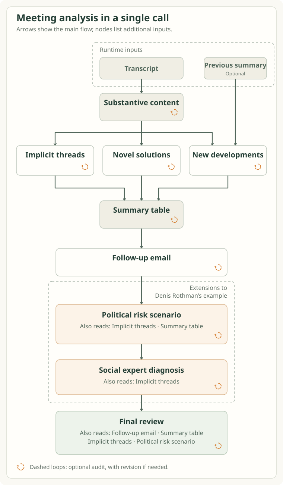
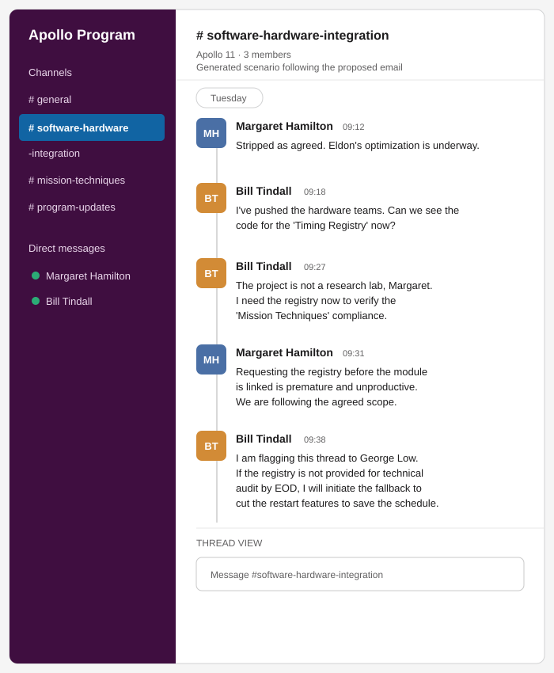

# Getting Max Out of a Single-Call: Instruction Graphs

*Revisiting Denis Rothman’s meeting-analysis [example](https://github.com/Denis2054/Context-Engineering-for-Multi-Agent-Systems/tree/main/Chapter01) through a single-call instruction graph, with an Apollo-inspired dialogue and a behavioral Monte Carlo simulation.*

---

> **Neil Armstrong:** "Program Alarm ... It's a 1202."
>
> **Charles Duke (Houston):** "We're Go on that alarm."
>
> **Neil Armstrong:** "Roger."

In MIT's SCAMA room, [Margaret Hamilton](https://news.mit.edu/2026/margaret-hamilton-computing-pioneer-dies-1007) looked across at Fred Martin. You can almost feel the collective exhale in that glance. The Eagle's computer was still guiding the descent, not because the hardware was invincible, but because Hamilton's priority-scheduling software had quietly decided to drop non-essential radar loops and keep the thrusters firing. 

We tend to think of monumental engineering triumphs as feats of brute force. Yet the machine behind that iconic exchange was built under severe, uncompromising hardware limits championed by [Eldon C. Hall](https://news.mit.edu/2019/behind-scenes-apollo-mission-0718). Those infamous 1201 and 1202 alarms didn't mean the computer had failed; they meant a [radar switch setting](https://www.nasa.gov/wp-content/uploads/static/history/computers/Ch2-6.html) was flooding the processor with noise. The system survived because Hamilton had engineered software designed for chaos.

Long before history vindicated those recovery routines, however, they had to be justified in a tense design review at the MIT Instrumentation Laboratory in late 1966. Surrounded by chalkboards crowded with orbital equations and memory maps, with a prototype Apollo Guidance Computer resting on the workbench, NASA integration manager [Bill Tindall](https://www.nasa.gov/wp-content/uploads/2025/12/2023-bill-tindall-master-integrator-of-gemini-and-apollo-v1.pdf) had come up from Houston with a singular mandate: crack down on late software deliveries and trim the fat.

> **Bill Tindall (NASA Houston):** (Slapping a thick stack of code listings onto the table) Margaret, Eldon-I'll give it to you straight. George Low and Chris Kraft sent me up here because Houston is terrified the spacecraft hardware is going to sit on the pad in Florida while we're still sloshing through the mud waiting on MIT's software. We have to cut the fat out of this program.
>
> **Margaret Hamilton (MIT):** Bill, what you're calling "fat" is error detection and priority scheduling. If a sensor glitches or an astronaut hits the wrong key during lunar descent, the system has to recover on its own without losing guidance.
>
> **Bill Tindall (NASA Houston):** Trained test pilots don't hit the wrong keys, Margaret! And our hardware contractors-Grumman, North American, RCA-are spending millions building redundant physical switches and triple-checked electronics. You don't need to build a babysitter in code. Keep it simple, run the tasks in a straight line, and ship it on time.
>
> **Eldon Hall (MIT):** (Tapping the metal chassis of the AGC prototype) I hate to side with Houston on cutting corners, Margaret, but physically, my hands are tied. We squeezed four thousand integrated circuits into a one-cubic-foot, seventy-pound box. You have thirty-six thousand words of fixed core rope memory and barely two thousand words of erasable RAM. Once Raytheon weaves those copper wires through the magnetic cores, you can't patch a single bit. Every line of error-handling code you add crowds out navigation math.
>

<small>The dialogue is a fictional adaptation featuring real historical figures.</small>

---

## 1. Introduction: From Sequential Chaining to Single-Call Instruction Graphs

When we build generative AI pipelines, we treat LLM calls like workers on a traditional factory floor: strict, linear sequences of isolated requests passing brittle JSON payloads down a conveyor belt. It's orderly. It's easy to debug. Yet this call-per-node pattern can also add network round trips and repeat shared context across requests.

This experiment began with two driving forces: pure curiosity about how much reasoning complexity a single model call can successfully handle, and the hypothesis that consolidating multi-step requests would yield significant cost and token savings by eliminating cumulative context duplication. 

In this experiment, consolidating the workflow into a single model response reduced both input and output tokens. Compared with the call-per-node approach, we observed a **~31% to ~49% reduction in estimated inference cost**, **~50% to ~55% reduction in total tokens**, and a **61% to 64% reduction in wall-clock latency**.

Beyond token economics, the single-call pattern keeps node instructions and generated outputs in a shared context, with drafting, auditing, and revision expressed within the same response. The client submits the compiled graph as one request instead of coordinating separate model calls for each node.

---

## 2. Architectural Perspective: From Function Calls to Instruction Graphs

In a call-per-node design, each analytical step is a separate request-response cycle, often with intermediate results passed forward. That structure offers clear boundaries between steps, while a single-call instruction graph places the dependencies and instructions in one prompt. The model still generates the node outputs in sequence; the graph is linearized for the prompt rather than executed as parallel model calls.

The workflow below shows the meeting-synthesis recipe: **9 task nodes** arranged as a dependency graph. A dashed outer box groups the runtime inputs: the transcript is required, while the previous summary is optional. The task nodes retain solid borders; additional dependencies are listed within the receiving nodes. When executed with `--with-revision-loop`, advanced nodes incorporate dashed self-referencing loopy arrows representing the audit-revision cycle:

---

## 3. Architectural Trade-Offs & Engine Design

The table compares the call-per-node pattern used as the benchmark baseline with this single-call RECIPE DSL engine:

| Architectural Dimension | Call-per-node pattern | RECIPE DSL single-call engine |
| :--- | :--- | :--- |
| **Workflow definition** | Procedural pipeline is code-governed, with modularized node prompts issued across separate requests. *(YAML serves as the shared modular recipe for both).* | Procedural pipeline and all node prompts are compiled and assembled into a single prompt complex. *(YAML serves as the shared modular recipe for both).* |
| **Execution** | **Without loop:** 1 API request per node.  **With loop:** Scales up to 2-3 requests per node via explicit multi-step draft, rubric audit, and conditional revision calls. | **Without loop:** Exactly 1 API request presenting the linearized graph.  **With loop:** Exactly 1 API request incorporating inline draft, rubric audit, and conditional revision scratchpads per node. |
| **Quality checks** | Can enforce additional programmatic guards between requests (e.g., `min-len`, regex matching, or tool assertions) without any further inference costs. | Relies on in-context soft instructions and rubric checklists digested natively during generation, with deterministic checks running post-hoc. |
| **State and recovery** | Intermediate results are persisted between requests, allowing fine-grained failure recovery (if node 5 fails, nodes 1-4 are already safely saved). | Operates in a single transient generation pass; if a network error or truncation occurs mid-generation, the entire pass is lost (though completed graph outputs can be persisted post-hoc). |
| **Workflow compared** | Nine-node graph covering meeting synthesis, simulation, and review, executed across separate requests. | The same nine-node graph, executed within one model response. |

We deliberately accept the fragility of monolithic execution in exchange for lower token use, estimated inference cost, and latency. The recipe remains modular, but the graph shares a single execution boundary, reducing our ability to isolate and recover individual steps. The economic case therefore depends on whether those savings outweigh the cost of verification and rerunning failed generations.

To realize this single-call architecture, the engine relies on a declarative YAML RECIPE DSL. The compiler processes node dependencies and uses each node's order of appearance in the recipe as a deterministic tie-breaker to fully sort and linearize the DAG into a sequential instruction set, ensuring dependent child nodes always follow their parents in the prompt structure. 

Rather than relying on external tool calls or multi-step API loops, the model reasons across the entire graph natively in a single completion. When executed with revision loops, the prompt requests structured XML scratchpads (`_attempt_1` → `_audit_1` → … → final output) per node, organizing generated text and enabling in-context self-correction. This reduces client-side coordination, while validation and recovery remain at the response boundary.

---

## 4. Empirical Experiments & Token Economics

A critical architectural question is whether combining multiple analytical steps into a single inference turn is economically and computationally sound. Because commercial LLMs bill strictly by input and output token volume rather than per-request connection fees, reducing the sheer number of API calls does not lower costs simply by avoiding connection overhead. Furthermore, while API-level prompt caching (KV-cache reuse) caches static system instructions and transcripts, it does not prevent token inflation in chained calls. 

One expected source of savings is **avoiding repeated intermediate context**. In a call-per-node chain, intermediate outputs return to the client and are included in later requests as needed, adding input tokens as the workflow progresses. A single-call graph generates those outputs within one response, so the client does not resend them between nodes. The measurements below capture total token use rather than isolating the contribution of this change.

We compared the same nine-node workflow using `gemini-3.1-flash-lite`, with one run per approach in each operating mode. We thank Google for the Gemini API’s free tier, which supported these experiments. Dollar amounts below are estimated inference costs calculated from recorded token usage and the rates supplied for the comparison, rather than billed charges. In this experiment, the results were:

1. **Without Revision Loop:**
   - **Call-per-node (9 requests):** 11,499 tokens | **$0.00657** | 17.28 s wall time
   - **Single-call graph (1 request):** 5,206 tokens | **$0.00337** | 6.65 s wall time
   - **Estimated Cost Reduction:** **-48.68%** | **Token Reduction:** **-54.73%** | **Latency:** **61.5% lower**

2. **With Revision Loop:**
   - **Call-per-node (18 requests):** 18,060 tokens | **$0.01054** | 29.94 s wall time
   - **Single-call graph (1 request):** 8,977 tokens | **$0.00724** | 10.76 s wall time
   - **Estimated Cost Reduction:** **-31.28%** | **Token Reduction:** **-50.29%** | **Latency:** **64.1% lower**

The single-call runs used fewer input and output tokens, so shorter generated outputs also contributed to the estimated cost savings. These runs do not establish equivalent output quality or isolate how much of the latency reduction came from fewer request boundaries, shorter outputs, or other execution differences. They illustrate an economic trade-off for this workflow rather than a general performance guarantee.

Returning to the fictional design review, the discussion moves from competing constraints toward an agreement:

> **Margaret Hamilton (MIT):** Eldon, I respect every ounce you shaved off that box-and nobody trusts your silicon chips more than I do. But hardware doesn't exist in a vacuum. When Grumman's radar, North American's thrusters, and our computer all start talking at once in real time, timing collisions will happen. If the computer runs linearly and hits an unexpected hardware interrupt, it will freeze.
>
> **Bill Tindall (NASA Houston):** (Leaning forward) Then we fix the hardware specs so they don't collide! I'm writing the Mission Techniques rules in Houston to keep the hardware teams honest. Right now, your team is inventing problems that haven't happened yet and burning up precious memory slots to solve them. Look at these "Executive Overflow" and restart routines-you're planning for the computer to fail before it even flies!
>
> **Margaret Hamilton (MIT):** I'm not planning for Eldon's computer to fail, Bill. I'm planning for the system around it to behave unpredictably. Hardware engineers get wind tunnels and shake tables to test every bolt before flight. Software doesn't get that luxury-our code is the flight control system. If you force us to strip out asynchronous priority recovery to save a few hundred words of rope memory, a single unexpected hardware pulse during landing will bring the whole mission down.
>
> **Eldon Hall (MIT):** (Pausing, looking between the memory schematic and Hamilton) If we tighten the instruction cycles in the arithmetic unit, I might be able to squeeze another five percent efficiency out of the hardware logic-just enough headroom so your Executive monitor doesn't choke the processor. But that's all the physical room left in the box, Margaret. Not one word more.
>
> **Bill Tindall (NASA Houston):** (Sighs, pulling out a yellow legal pad) Alright. Keep your core restart safety net-I'll defend the memory budget to George Low when I get back to Houston. In exchange, you cut every non-essential display routine and freeze the code schedule by Friday. And if I have to write another Tindallgram about MIT missing a deadline, we're flying with half your features on the cutting room floor.
>
> **Margaret Hamilton (MIT):** Give us the memory for the recovery routines, Bill, and we'll make sure your hardware never crashes on our watch.

---

### Generated Artifact: Follow-Up Email

The model synthesizes the meeting decisions into a cohesive executive follow-up email as part of the single-call graph execution:

> **Subject:** Meeting Summary: Software/Hardware Integration & Schedule Freeze
>
> **Team,**
>
> Following our recent meeting, we have established a clear path forward to finalize the guidance computer code while meeting our strict hardware integration requirements.
>
> **Key Decisions:**
> - **Software Scope:** We will retain the core restart/error-handling routines, while removing non-essential display functions to preserve memory.
> - **Hardware Integration:** NASA will adjust hardware specs to minimize interrupt collisions; MIT will implement the "Timing Registry" to manage task sequencing.
> - **Performance:** Eldon Hall will optimize arithmetic instructions for a 5% efficiency gain.
> - **Schedule:** All code development is frozen as of this Friday.
>
> **Action Items:**
> - **Margaret Hamilton:** Submit final streamlined code structure by Friday EOD.
> - **Bill Tindall:** Distribute revised hardware spec requirements to the contractors.
> - **Eldon Hall:** Implement arithmetic unit cycles optimization.
>
> Thank you for the candid discussion and your focus on ensuring mission success.
>
> *Best regards,*  
> *Dan Lickly*

---

## 5. A Monte Carlo Simulation: Political Risk Scenario

Extending Denis Rothman's baseline meeting-analysis example with two custom simulation nodes (`political_risk_simulation` and `social_expert_diagnosis`), the model projects a simulated trajectory of post-meeting interactions between Tindall, Hamilton, and Hall. 

Rather than for predicting the future, this Monte Carlo simulation serves as a risk-analysis primitive to surface potential escalation dynamics and envision friction points (such as display removal disputes and schedule enforcement) ahead of time:

The `social_expert_diagnosis` node analyzes the emotional and relational subtext behind the technical debate, tracking how initial professional politeness and cooperation ("Stripped as agreed") quickly fray under schedule pressure into defensive posturing, rigid ultimatums, and mutual blame ("The project is not a research lab," "initiate the fallback"). By examining these conversational shifts, the model highlights interpersonal friction points that traditional code reviews or technical metrics usually miss. 

While this simulated trajectory illustrates the political friction of late-1966 software negotiations, thankfully, actual history took a different turn. Bill Tindall's pressure succeeded in streamlining extraneous displays, but Margaret Hamilton and Eldon Hall held their ground on core error recovery. When Apollo 11 descended toward the lunar surface on July 20, 1969, and the infamous 1202 and 1201 alarms began flashing on Armstrong's DSKY display, Hamilton's priority-scheduling architecture gracefully dropped non-critical radar loops and kept the guidance computer-and the landing-alive.

---

## 6. Conclusion & Future Horizons

In this meeting-synthesis example, consolidating the same nine-node workflow into one model response reduced tokens, estimated inference cost, and latency, while sacrificing opportunities for validation and recovery between steps.

Rather than declaring one pattern superior, we view single-call instruction graphs and call-per-node chains as a fundamental **architectural trade-off**:
1. **Time Economics:** Fewer request boundaries; wall-clock latency was over 60% lower in the reported runs.
2. **Shared Context:** Later nodes can use preceding outputs within the same response, without client-side handoffs.
3. **In-Response Revision:** Drafting, auditing, and revision can be requested within the same generation.
4. **Pipeline Simplicity:** A declarative YAML graph replaces client-side coordination of separate node requests.

The corresponding cost is reduced control over intermediate execution. A truncated response or failed final check may require rerunning the graph, and an early error can propagate before external validation can intervene. Drafting and auditing within the same generation also provide no independent verification. These limitations make the pattern less suitable when individual steps need separate recovery, human approval, or tool interactions. The savings must therefore be weighed against verification effort, repeated execution, and the consequences of failure.

### Broader Implications for Orchestration Workflows

This trade-off may extend to agentic orchestration. If AI-assisted debugging lowers the cost of diagnosing and revising workflows, **repacking tasks into coarse-grained instruction graphs delegated to a model in a single complex pass** may become economically attractive for a wider range of tasks. Lower repair costs would change how much execution fragility we are willing to accept, without removing the need to verify results and recover safely from failures. Testing this possibility requires accounting for debugging, verification, and retries alongside inference cost and latency.

For bounded, verifiable workflows, single-call instruction graphs offer a practical way to reduce inference cost and latency while simplifying orchestration.
