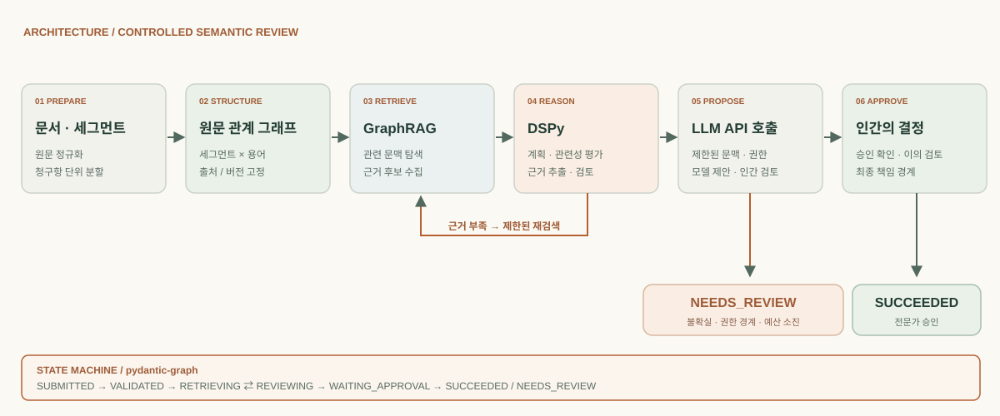

# 엔지니어링 고민과 아키텍처 설계 과정

통신 특허 번역 검수 실무를 경험하며 마주한 화두는 명확했습니다. AI 시대에 휴먼 리뷰어의 과중한 업무 부담을 어떻게 실질적으로 덜어주면서도, 용어 불일치로 인한 금반언 등 치명적인 법적 리스크를 안전하게 관리할 수 있을까요? PatentLinter를 설계하며 얻은 기록입니다.

## 금반언 리스크와 리뷰어의 부담: 문자열 및 로컬 모델의 한계

통신 특허 국내 출원 번역 감수 실무를 수행하며 가장 경계했던 지점은 번역어의 불일치로 인한 법적 리스크, 특히 심사 과정에서 심사관이나 출원인에게 불리하게 작용하는 **금반언**의 위험이었습니다. 특허 번역 검수는 단순한 어휘 매칭을 넘어, 청구범위와 명세서 전반의 기술적 의미와 법적 관계를 엄격히 일치시켜야 하는 고도의 작업입니다.

근본적으로 특허 번역이 이토록 까다로운 이유는, 한국어와 영어의 유창한 언어 능력을 갖추는 것만으로는 턱없이 부족하기 때문입니다. 해당 기술 분야의 심도 있는 기술적 전문성과 청구범위의 권리경계를 다루는 리걸 마인드가 동시에 요구되는데, 이 세 가지 교집합을 모두 충족하는 전문 인력을 안정적으로 확보하고 일관된 품질을 유지하는 것은 실무 현장에서 늘 거대한 병목이었습니다.

초기에는 정규식(Regex)과 기계적인 Jaccard 유사도, 그리고 Sentence-Transformer 기반의 의미적 임베딩(Semantic Embedding) 유사도를 결합하여 접근했습니다. 그러나 표현이 달라도 동일한 기술적 개념일 수 있고, 임베딩 공간에서 거리가 가까워도 부정어나 조건 하나로 권리범위가 완전히 뒤집히는 특허 언어의 특성상 단순한 유사도 측정은 오탐과 누락을 반복할 뿐이었습니다. 무엇보다 리뷰어의 과중한 피로도를 덜어주기에는 역부족이었습니다.

초기에는 온프레미스 기반의 로컬 모델 조합을 검토했습니다. 번역과 검수 과정을 단편적이고 반복적인, 좁은 범위(Narrow-scoped)의 서브 태스크들의 조합으로 환원할 수 있을 것이란 나이브한 접근이었습니다. 그러나 언어에는 **문서 전반을 아우르는 거시적 맥락**이 존재하며, 특히 기존 기술 사양과 선행 문헌의 전체적인 흐름을 고려해 번역과 표현이 유기적으로 달라져야 합니다. 규칙 기반 방식이나 세분화된 세부 태스크의 단순 조합만으로는 이러한 광범위한 맥락을 담아내기에 근본적인 한계가 있었습니다.

또한 기술의 진화에 따른 용어 변화, 특허 명세서 작성자(Drafter) 및 번역가 저마다의 서술 스타일을 로컬 모델의 파인튜닝만으로 학습하고 적응시키는 것도 벅찼습니다. 결국 당시 검토한 기계적인 규칙 기반 접근과 로컬 모델의 조합만으로는 특허 언어의 다양한 표현과 문서 전체의 맥락을 충분히 다루기 어렵다고 판단했습니다.

오히려 비용 효율적이면서도 강력한 범용 추론 능력을 갖춘 OpenAI, Gemini, Claude 계열의 Closed Model을 활용하되, 이를 구조화된 파이프라인과 그래프 기반 맥락으로 통제하는 것이 훨씬 합리적이고 적응력 있는 접근법임을 확인할 수 있었습니다. 기계적 탐색은 후보 발견과 변경 범위 통제에 남기고, 해석이 필요한 판단은 검증된 Closed Model 기반의 근거 제시와 전문가 핸드오프 구조로 분리했습니다.

## 모델에는 해석을, 시스템에는 통제를 맡겼습니다.

복잡계 물리학의 관점에서 LLM을 바라보면, 학습된 매개변수와 주어진 문맥에 따라 조건부 확률분포를 산출하는 시스템으로 이해할 수 있습니다. 토큰 시퀀스의 생성은 샘플링 방식에 따라 확률적 과정이 되며, 이러한 언어 생성 모델을 확률적 앵무새(Stochastic Parrot)에 비유하기도 합니다. 프롬프트와 맥락 주입은 마치 외부 장(External Field)처럼 조건부 확률분포에 작용하여 생성 결과를 원하는 방향으로 유도한다고 볼 수 있습니다.

이를 구현하기 위해 원문 명세서를 세그먼트와 기술 용어의 관계 그래프로 구성하고, 그래프의 구조와 출처를 엄격히 고정했습니다. GraphRAG는 질문과 관련된 문맥을 찾아오고, DSPy는 복잡한 판단 과정을 하나의 프롬프트에 누적하는 대신 계획(Planner) → 관련성 평가(Reranker) → 근거 추출(Extractor) → 검토(Reviewer)의 단계로 분리하여 각 모듈의 책임을 명확히 합니다. 이러한 분리는 오류가 발생했을 때 어느 단계에서 문제가 생겼는지 추적하고, 전체 파이프라인을 변경하지 않고도 개별 모듈을 평가하고 개선할 수 있도록 하기 위한 설계입니다.

LLM API 호출은 승인과 비용의 경계 안에 두어, 모델이 번역의 의미와 용어 선택에 관한 **근거 있는 제안**을 하되 원문 그래프를 임의로 수정하거나 전문가의 최종 승인을 대신하지 못하도록 설계했습니다. 승인된 용어나 세그먼트가 변경될 때도 전체 문서를 다시 처리하지 않고, 그래프가 가리키는 영향 범위만 선별하여 수정 가능한 영역을 제한합니다. 근거가 부족하거나 판단이 불확실한 경우에는 무조건 통과시키는 대신 **NEEDS_REVIEW** 상태로 남깁니다.

## 아키텍처 설계

## 평가 기준은 어떻게 만들어지는가

특허 번역 검수의 품질을 어떻게 평가할 것인가는 모델을 선택하는 것만큼이나 어려운 문제였습니다. 코딩 문제처럼 테스트의 통과 여부로 성공과 실패를 구분할 수 있는 이진(Binary)의 세계와 달리, 번역에서는 무엇이 치명적인 오역이고 어디까지가 허용 가능한 표현의 변이인지 명확히 구분하기 어렵습니다. 특히 기술적 의미의 정확성, 용어의 일관성, 법적 위험은 서로 연관되어 있으면서도 하나의 정답률로 환원하기 어려운 평가 차원입니다.

따라서 정답률보다 중요한 것은 실패의 유형을 구분하고 그에 따른 평가 원칙을 세우는 일입니다. 표현의 유창함과 별개로 핵심 정보의 누락 여부, 원문의 기술적 의미 보존, 용어 및 표현의 일관성, 청구범위의 법적 정합성 등을 독립적인 평가 기준으로 삼아야 합니다. 그러나 이러한 기준조차 사전에 완벽하게 정립할 수는 없습니다. 실무 아키텍처의 원칙(Principle)은 결국 휴먼 인 더 루프(HITL) 피드백을 통해 경험적으로(Empirically) 결정되고 일관성(Coherent) 있게 다듬어져야 하기 때문입니다.

## 무엇을 자동화하지 않을지 결정하는 일

특허 번역 검수 실무와 복잡계 네트워크 연구를 거치며 깨달은 점은, 좋은 AI 아키텍처란 더 강력한 모델 하나에 기대는 것이 아니라 **어떤 지식은 구조로 고정하고 어떤 판단은 맥락에 맡길지** 그 경계를 정교하게 긋는 데 있다는 것입니다. 그래프는 출처와 관계를 지탱하고, LLM은 의미적 모호성을 검토하며, 타입과 상태 전이는 모델의 동작을 통제합니다.

법적 타당성, 번역의 자연스러움, 기술적 정확성은 각각 변리사, 번역 전문가, 기술 전문가의 최종 확인(Sign-off)을 거쳐야 합니다. PatentLinter의 본질적인 목적은 전문가들이 번역 검수 과정에서 마주하는 반복적이고 소모적인 기계적 업무를 덜어주고, 보다 고차원적이고 핵심적인 분석에 집중할 수 있도록 돕는 데 있습니다.

현재 검증된 검색 기능과 오프라인 참조 구현을 바탕으로 이 경계를 구체화하고 있습니다. 다만 AI가 제시하는 복잡한 검토 제안과 근거를 인간 전문가가 가장 직관적이고 피로감 없이 처리할 수 있도록, HITL(Human-in-the-Loop) 상호작용의 인터페이스와 워크플로를 어떻게 설계하고 제공할 것인가는 앞으로 본격적으로 파고들어야 할 핵심 방법론적 과제로 남아 있습니다. 기계가 반복적인 검토를 지탱하고 사람이 고차원적 판단에 집중하는 구조 속에서, 시스템은 비로소 실무의 신뢰할 수 있는 도구로 완성됩니다.

